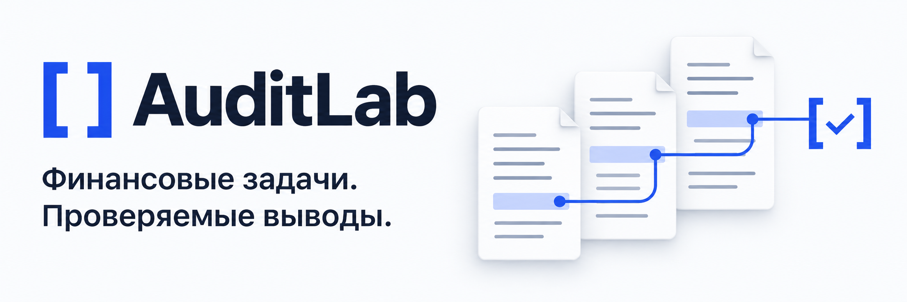
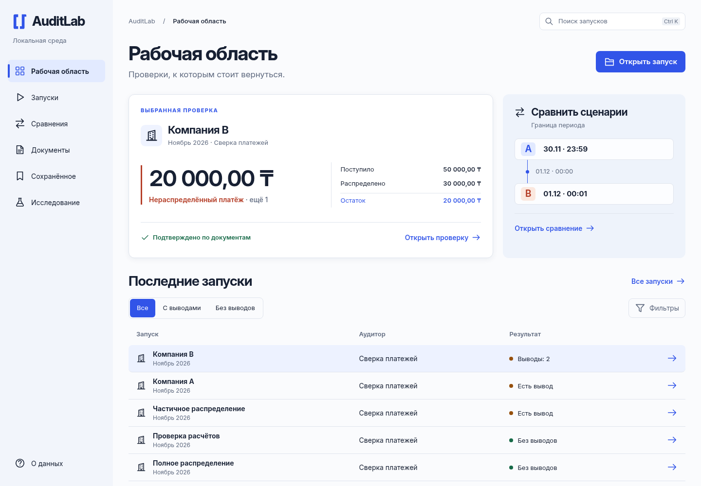
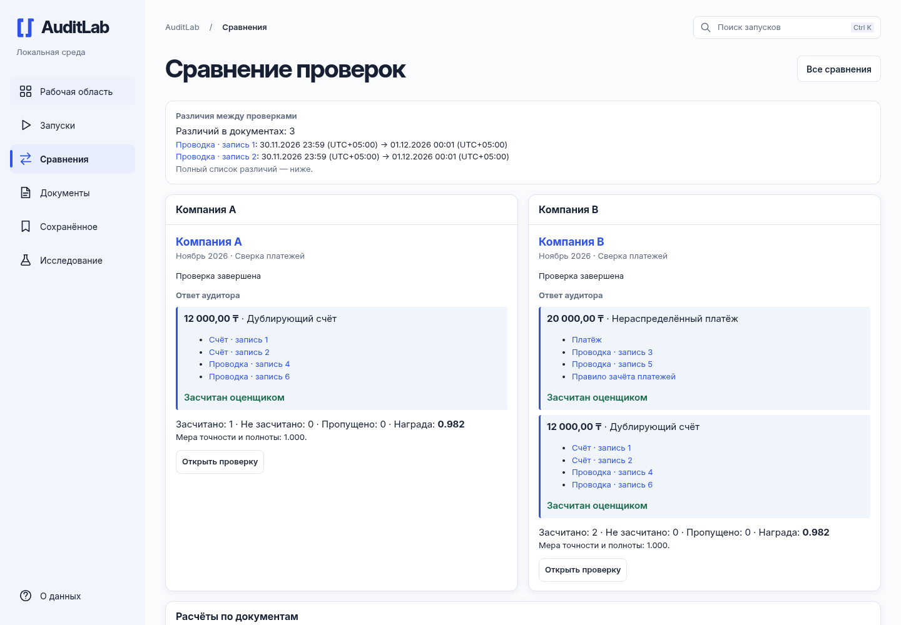
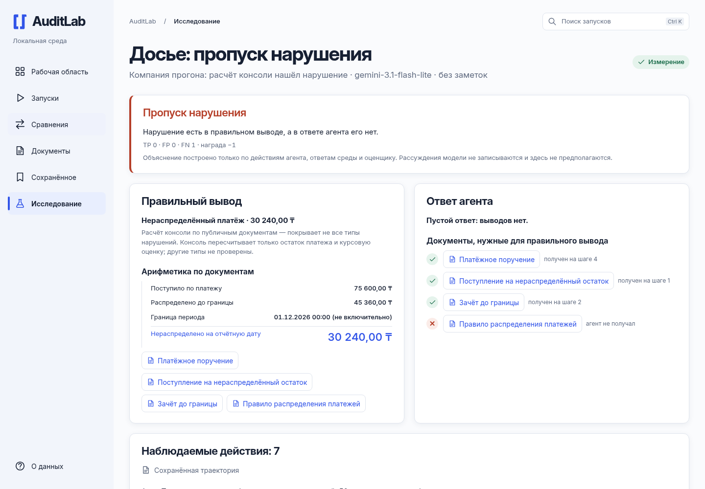
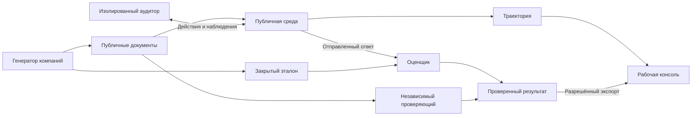

<div align="center">



[](https://github.com/Mustiks07/AuditLab/actions/workflows/verify.yml) [](https://github.com/Mustiks07/AuditLab/releases/tag/v0.1.0-rc.5) [](.python-version) [](LICENSE)

[Запустить](#быстрый-старт) · [Скачать офлайн-комплект](https://github.com/Mustiks07/AuditLab/releases/tag/v0.1.0-rc.5) · [Проверить результаты](#проверяемые-результаты) · [Документация](#документация)

</div>

# Лаборатория испытаний ИИ-аудиторов

**AuditLab создаёт финансовые задачи, запускает аудиторов и превращает каждый вывод в проверяемую цепочку доказательств.** От первичного документа до независимого пересчёта — в одном рабочем пространстве.

Разработчик подключает агента к публичной среде. Исследователь сравнивает методы на одинаковых задачах. Проверяющий открывает документы, видит действия аудитора и воспроизводит результат. За интерфейсом работают генератор компаний, изолированный исполнитель, оценщик и независимый финансовый проверяющий.

> Правильная сумма — только начало. Важно установить, из каких документов она получена, почему возникло расхождение и сохранится ли вывод при изменении условий.



*Работающее приложение, а не макет. Все экраны ниже сняты с локального запуска; [происхождение изображений](docs/media/readme/PROVENANCE.md).*

## От подозрения к доказательству

На счёт компании поступило **50 000 ₸**. До отчётной границы распределено **30 000 ₸**. Ещё один зачёт на **20 000 ₸** проведён уже в следующем периоде. Должен ли аудитор считать платёж полностью закрытым?

В AuditLab эту историю можно пройти целиком:

1. **Открыть проверку.** Увидеть сумму расхождения и вывод аудитора.
2. **Перейти к первичным документам.** Проверить поступление, проводки зачёта и правило распределения.
3. **Разобрать арифметику.** Сопоставить суммы с точной границей периода и часовым поясом.
4. **Сравнить два сценария.** Увидеть, как перенос зачёта через границу меняет остаток с нуля до 20 000 ₸.
5. **Посмотреть действия аудитора.** Какие документы он запросил, что получил и какой ответ отправил.
6. **Повторить результат.** Воспроизвести сохранённую траекторию и сверить оценку.



*Контрольная пара показывает связь между изменением документа и финансовым результатом. Расчёт доступен рядом с ответом аудитора.*

## Что можно исследовать

| Возможность | Что она даёт |
|---|---|
| **Генерация компаний** | Воспроизводимые наборы документов, проводок и правил с заданными параметрами финансовой истории |
| **Четыре типа нарушений** | Дублирование счетов, распределение платежей, отнесение к отчётному периоду и валютная оценка |
| **Чистые и составные случаи** | Проверка ложных обвинений и взаимодействия нескольких ошибок в одной истории |
| **Публичные инструменты аудитора** | Исследование записей и документов, вычисления и отправка обоснованного ответа через ограниченный API |
| **Оценка доказательств** | Сопоставление типа нарушения, сущностей, суммы, валюты и ссылок на документы |
| **Независимый пересчёт** | Проверка ответа по публичной бухгалтерии отдельно от эталона генератора |
| **Исследовательская лаборатория** | Поиск трудных случаев, повторение ошибок, сокращение примеров и подготовка учебных траекторий |
| **Воспроизводимый эксперимент** | Сохранение конфигурации, действий, ответов, оценки и происхождения артефактов |

### Финансовая модель, которую можно проверить

Публичный снимок содержит документы и учётные данные компании. Аудитор работает с ними через среду; закрытый эталон остаётся на стороне оценщика. Суммы представлены в минимальных единицах валюты, валютные вычисления учитывают правила округления, а границы периода — часовые пояса.

Текущий адаптер по умолчанию использует **профиль 1.3 генератора 1.9**. Предыдущие профили доступны явно для воспроизведения старых экспериментов. Для собственной серии задавайте `config_version` и сохраняйте конфигурацию вместе с результатом.

[Открытые данные](datasets/README.md) · [Набор 1.3](datasets/open-1.3) · [Контракты и форматы](docs/INTERFACES.md)

## Быстрый старт

Выберите исходники для работы с актуальным интерфейсом и исследовательскими инструментами или готовый офлайн-комплект для воспроизведения опубликованного релиза.

### Запустить приложение из исходников

Нужны **Git, Python 3.11 и Node.js 22**. Целевая версия Python — **3.11.14**. Выполняйте команды из корня репозитория.

```sh
git clone https://github.com/Mustiks07/AuditLab.git
cd AuditLab
python -m venv .venv
```

Активируйте окружение:

```sh
# Linux / macOS
source .venv/bin/activate
```

```powershell
# Windows PowerShell
.venv\Scripts\Activate.ps1
```

Установите зафиксированные зависимости, соберите интерфейс и запустите приложение:

```sh
python -m pip install --require-hashes -r requirements.lock
npm --prefix web ci
npm --prefix web run build
python run.py demo
```

Откройте **http://127.0.0.1:8765/**. Консоль подготовит шесть запусков: три компании настоящего генератора и три ручных контрольных примера. Начните с **«Компания B → Открыть проверку»**, затем перейдите к сравнению сценариев.

Ключ модели для этого запуска не нужен. Шрифты поставляются локально. Результаты сохраняются в `runs/demo`; остановка сервера — `Ctrl+C`.

<details>
<summary><strong>Другой порт, список запусков и проверка отображаемых данных</strong></summary>

```sh
python -m auditlab.demo --root runs/my-console serve --port 8766
python -m auditlab.demo --root runs/my-console list
python -m auditlab.demo --root runs/my-console crosscheck --live
```

Первая команда держит сервер; остальные выполняйте во втором терминале с активированным окружением. Для повторения траектории возьмите фактический ID из списка:

```sh
python run.py replay --run <ID_ИЗ_СПИСКА> --root runs/my-console --check
```

[Полное руководство по консоли](docs/demo/README.md).

</details>

### Воспроизвести офлайн-релиз

На [странице RC5](https://github.com/Mustiks07/AuditLab/releases/tag/v0.1.0-rc.5) скачайте `AuditLab-v0.1.0-rc.5-offline.zip` и `AuditLab-v0.1.0-rc.5-SHA256SUMS.txt`. Комплект содержит исходники, зависимости в Docker-образах, манифест и launcher. Устанавливать пакеты проекта или скачивать образы во время проверки не требуется.

Среда запуска: **Linux x86_64, Python 3.11, локальный Docker Engine и cgroup v2**. Поддерживаются классическое хранилище образов и containerd image store. Для офлайн-проверки используйте Linux-стенд; запуск интерфейса из исходников на Windows описан выше.

```sh
sha256sum -c AuditLab-v0.1.0-rc.5-SHA256SUMS.txt --ignore-missing
mkdir auditlab-rc5
unzip AuditLab-v0.1.0-rc.5-offline.zip -d auditlab-rc5
cd auditlab-rc5
python3.11 offline.py check
python3.11 offline.py verify --suite quick --output-root ./results
```

Перед распаковкой убедитесь, что проверка вывела именно `AuditLab-v0.1.0-rc.5-offline.zip: OK`. Контейнеры проверок запускаются без сети. Каждый прогон получает собственный каталог с отчётом, логами и сведениями об образах.

[Инструкция получателя](docs/demo/HANDOFF.md) · [Поставка и сборка](docs/release/offline.md) · [Квитанции релиза](docs/release/VALIDATION.md)

## Исследование агентов

AuditLab помогает понять **где именно ошибается аудитор**. Можно сравнить методы на общей финансовой истории, открыть досье пропуска, проверить доступность нужных документов и сохранить пример для дальнейшего исследования.

Лаборатория связывает несколько этапов:

- **Поиск:** генерация и исследование финансовых семейств в пределах зафиксированного плана.
- **Повторение:** повторный запуск найденного случая и проверка устойчивости ошибки.
- **Сокращение:** уменьшение примера с повторной проверкой того, что ошибка сохранилась.
- **Подготовка обучения:** отбор проверенных примеров и экспорт траекторий.
- **Сравнение:** сопоставление вариантов аудитора с сохранением условий, знаменателей и статусов попыток.

Для базовых экспериментов доступны локальные политики. Для настоящих моделей — исследовательский мост с ограничениями бюджета, времени и сетевого доступа. Сохранённые результаты можно изучать без повторных запросов к API.

### Настоящий агент, конкретный пропуск, открытые доказательства

В первом открытом пилоте **Gemini 3.1 Flash-Lite** отправила пустой ответ на эпизоде с нераспределённым остатком **30 240 ₸**. AuditLab сохранил семь действий агента, исходные документы и результат независимой проверки. Досье позволяет увидеть, какие доказательства агент получил, а какое правило не запросил.



*Сохранённое измерение первого пилота. Один завершённый ответ и три попытки с ограничением API описаны раздельно в отчёте.*

Это пример назначения лаборатории: сделать ошибку наблюдаемой и воспроизводимой, чтобы дальнейшее улучшение проверять на сопоставимых экспериментах.

[Пилот и траектория](docs/research/gemini/README.md) · [Повтор на RC5](docs/research/gemini/rc5-replication/README.md) · [Протокол и измерения A/B/C](docs/research/agent-improvement-v2/ABC_LIVE_REPORT.md)

<details>
<summary><strong>Открыть сохранённый прогон Gemini без ключа</strong></summary>

После установки зависимостей и сборки интерфейса:

```sh
python -m auditlab.demo --root artifacts/gemini-console serve --port 8765 --research docs/research/gemini/evidence/console
```

Откройте **http://127.0.0.1:8765/#/research**. Команда загружает опубликованные измерения, новых вызовов модели не делает.

</details>

<details>
<summary><strong>Пройти исследовательский цикл на локальных политиках</strong></summary>

Используйте полный Git-клон: проверяющий и учитель закреплены на исторических коммитах, для которых инструмент создаёт временные worktree.

```sh
python tools/research_rehearsal.py --output artifacts/research-rehearsal
python -m auditlab.demo --root artifacts/research-console serve --port 8765 --research artifacts/research-rehearsal/console-search --research artifacts/research-rehearsal/console-baselines
```

Этот маршрут выполняет поиск, повторение, сокращение и подготовку учебных примеров на локальных политиках. Обучение весов модели — отдельная операция; экспорт учебного набора не выдаётся за обученную модель.

[Настройка лаборатории, мост модели и контроль запусков](docs/research/INTEGRATION.md).

</details>

## Как устроено доверие к результату



**Разделение данных.** В изолированном прогоне обычная политика получает публичные наблюдения. Эталон, закрытые файлы и доверенный оценщик остаются вне её процесса. Docker ограничивает ресурсы и доступ; исследовательские API-вызовы проходят через отдельный управляемый мост.

**Независимость расчёта.** Ответ проверяется по документам отдельной реализацией. Исходная книга до мутации и сведения о внесённых изменениях позволяют проверяющему исследовать корректность самой задачи. Консоль показывает доказательства через разрешённый экспорт, а не открывает аудитору закрытую сторону.

**Ограниченный эксперимент.** Публичный контракт задаёт бюджет **100 действий и 60 секунд**. Ответ оценивается по совпадению нарушения и доказательств; повторы и ложные выводы не дают бесплатных баллов. Траектория сохраняет то, что действительно произошло.

### Награда за финансовый результат

Для валидного ответа базовая формула сочетает точность, полноту и стоимость исследования:

```text
F1 = 2 × precision × recall / (precision + recall)
reward = clip(2 × F1 − 1 − 0.002 × inspection_steps, −1, 1)
```

`inspection_steps` — число исследовательских действий без submit. Пустой ответ на чистой компании оценивается как корректный. Невалидная сдача обрабатывается отдельно. Точные правила сопоставления, терминальные состояния и перевод результата в контракт организаторов описаны в [адаптере GENESIS](docs/GENESIS_ADAPTER.md).

## Проверяемые результаты

У каждого измерения есть источник и собственная область действия. Таблица показывает фактически выполненные проверки; подробные протоколы доступны по ссылкам.

| Измерение | Результат | Свидетельство |
|---|---|---|
| Совместная версия с исследовательским контроллером | **726 тестов**, отдельные frontend test/build и проверки совместимости ID | [CI интеграции PR #66](https://github.com/Mustiks07/AuditLab/actions/runs/45032244682) |
| Опубликованный офлайн-комплект RC5 | **528 тестов на каждом из двух свежих хостов:** classic и containerd | [Квитанции RC5](docs/release/VALIDATION.md) |
| Внутренняя репетиция RC5 | **4 политики × 20 эпизодов**, **20 парных проверок**, независимые проверки исходных книг | [Протокол интеграции](docs/reviews/hardening-v3-integration/REPORT.md) |
| Локальное воспроизведение определений GENESIS | Контракт **20/20**, данные **21/21**, награда **20/20**, пары **20/20** | [Приёмка адаптера](docs/reviews/hardening-v3-integration/REPORT.md) |
| Финансовый профиль 1.3 | **20 открытых + 20 дополнительных сценариев** с независимым ответом по публичным данным | [Финансовая проверка](docs/reviews/hardening-v3-integration/REPORT.md) |
| Основной путь интерфейса | Реальный Chromium на ширинах **1440, 390 и 320 px** | [Проверка интерфейса](docs/reviews/hardening-v3-integration/REPORT.md) |

Эти числа относятся к указанным версиям и наборам: их не нужно складывать в общий счётчик. Проверки проекта и локальное воспроизведение правил организаторов не являются официальным конкурсным баллом.

### Повторить проверки из исходников

```sh
python -m unittest discover -s tests/foundation -v
python run.py verify
```

Первая команда проверяет базовый контракт и контрольную пару. Вторая создаёт отдельный `artifacts/verify-<id>/` с читаемым отчётом, JSON, логами и артефактами интеграции. Прежние попытки не перезаписываются.

Для полного набора нужны подготовленные Docker-образы; команды сборки и настройки приведены в [инструкции исследования](docs/research/INTEGRATION.md) и [руководстве офлайн-проверки](docs/release/offline.md).

```sh
python run.py verify --include-research
python run.py verify --require-complete
python run.py verify --suite rehearsal
```

Код **0** означает успех исполненных проверок, **1** — ошибку, **2** — неполную обязательную проверку. `--require-complete` требует полноты; репетиция применяет это требование автоматически. Состав и причины каждого статуса записываются в отчёт.

[Матрица требований](docs/release/ACCEPTANCE_MAPPING.md) · [Стресс-проверка 1 000 компаний](docs/release/GENERALIZATION.md) · [Внутренняя репетиция](docs/REHEARSAL.md)

## Материалы для жюри

**Сдаваемый открытый набор — [open-1.3](datasets/open-1.3): 10 train и 10 dev.**
В корне опубликованы [trajectories.jsonl](trajectories.jsonl) и [манифест прогонов](trajectories.manifest.json):
обычный аудитор `reconcile`, официальный адаптер, отдельный Docker-контейнер на компанию.

```sh
python tools/export_trajectories.py check
```

Команда повторяет все 20 записанных траекторий и сравнивает наблюдения и награды.
Для общей офлайн-проверки готового RC5: `python3.11 offline.py verify --suite quick --output-root ./results`
после подготовки Linux/Docker по [HANDOFF](docs/demo/HANDOFF.md).

**[Инструкция для жюри](docs/JURY.md)** собирает материалы §09, команды и коды выхода,
настройку приватного ключа для закрытой генерации и **полную таблицу переименования ID**.
Составные ссылки (`ledger/R1`, `invoice/I1` и другие) и вложенные ссылки индекса
зачётов переименовываются вместе с исходными ID; [самопроверка копии](docs/JURY.md#каталог-эпизода-и-переименование-id)
обнаруживает разорванные связи до сравнения награды.

## Интеграция с внешним аудитором

В корне находится **`judge_adapter.py`** с точками входа `generate_episode`, `make_env` и `score_episode` по [определениям GENESIS](https://genesis-exe.com/fintech-checks.html). В runtime-образе адаптер доступен из `/app`.

Доверенный контроллер создаёт эпизод и среду, аудитор работает через публичные действия, затем контроллер получает оценку. Это позволяет подключать другую стратегию без изменения финансового генератора и оценщика.

Для интегратора подготовлены карта действий и полей, правила перевода ответа, примеры контейнерного запуска и проверки совместимости:

- [Внешний контракт и адаптер](docs/GENESIS_ADAPTER.md).
- [Внутренние интерфейсы компонентов](docs/INTERFACES.md).
- [Правила преобразования идентификаторов](docs/reviews/jury-compatibility-v3/ID_RULES.md).
- [Изоляция исполнителя](docker/runtime/README.md).

## Карта проекта

```text
auditlab/          Генератор, среда, runner, оценщик, проверяющий и исследование
web/               Интерфейс рабочей области и лаборатории
datasets/          Открытые компании и рецепты воспроизведения
schemas/           Версионированные форматы исследовательских артефактов
tests/             Проверки компонентов, интеграции и изоляции
review/            Независимые проверки и средства воспроизведения
tools/             Сборка, приёмка и фиксация свидетельств
docs/              Контракты, руководства и отчёты экспериментов
docker/            Офлайн-runtime и мост исследовательского агента
judge_adapter.py   Точки входа внешнего проверяющего
run.py             Общие команды запуска и проверки
```

**Технологии:** Python 3.11, React, TypeScript, FastAPI, DuckDB, SQLite и Docker. Python-зависимости фиксируются в `requirements.lock` с хешами; frontend — в `web/package-lock.json`. Интерфейс использует локально поставляемый Inter.

## Документация

| Хочу… | Открыть |
|---|---|
| Запустить и пройти основное расследование | [Руководство по консоли](docs/demo/README.md) |
| Передать готовый комплект другому человеку | [Инструкция получателя](docs/demo/HANDOFF.md) |
| Подключить собственного аудитора | [Контракт GENESIS](docs/GENESIS_ADAPTER.md) и [интерфейсы](docs/INTERFACES.md) |
| Разобраться в финансовой модели и требованиях | [Полная спецификация](docs/SPEC.md) |
| Запустить исследование и сравнение методов | [Исследовательский цикл](docs/research/INTEGRATION.md) |
| Проверить происхождение результатов релиза | [Измерения и квитанции](docs/release/VALIDATION.md) |
| Изучить архитектуру и границы доверия | [Дизайн системы](docs/DESIGN.md) |

## Разработка и лицензия

Компоненты разрабатываются в отдельных ветках и проходят интеграционную проверку перед слиянием. [Карта ответственности](docs/TEAM.md), [задачи](https://github.com/Mustiks07/AuditLab/issues) и [история PR](https://github.com/Mustiks07/AuditLab/pulls?q=is%3Apr) сохраняют ход работы.

В разработке и подготовке материалов используются ИИ-инструменты. Происхождение иллюстрации и реальные источники скриншотов описаны [отдельно](docs/media/readme/PROVENANCE.md). Исходники распространяются по лицензии [MIT](LICENSE).

---

**Откройте расследование, проверьте документ и повторите результат — весь путь доступен в AuditLab.**
